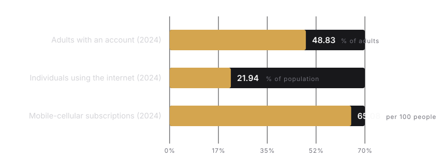
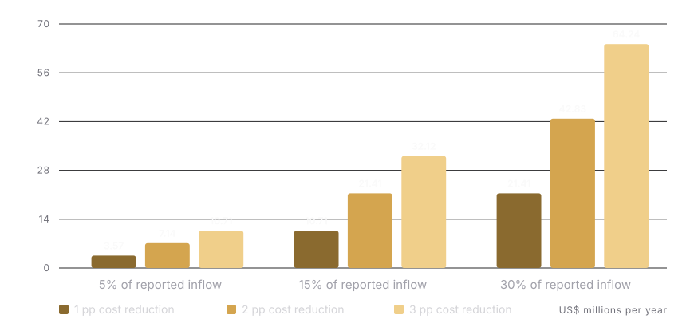

# Implementing Stablecoins in Ethiopia

## A Technical, Regulatory, and Economic Roadmap for a Licensed ETB Token on Cardano, with an Optional Midnight Privacy Layer

**Paper date:** 27 October 2026  
**Document type:** Technical research and implementation proposal  
**Intended readers:** National Bank of Ethiopia and other public authorities, banks and payment service providers, development partners, and blockchain engineering teams  
**Scope:** Privately issued, fully reserved stable-value payment instruments; domestic ETB use first; separately authorized cross-border corridors second

> **Regulatory status notice.** This paper does not assert that stablecoins are currently authorized in Ethiopia. Express written National Bank of Ethiopia (NBE) authorization is a precondition to issuance, distribution, exchange, custody, settlement, or facilitation. The proposed instrument is a regulatory and technical design for evaluation, not a description of an existing approved product.

## Executive Summary

Ethiopia should not begin with a freely traded, anonymously held, USD-denominated stablecoin. The more defensible starting point is a **licensed, fully reserved, one-to-one redeemable ETB tokenized e-money instrument**, issued by an approved Ethiopian entity and distributed through regulated banks and payment service providers. It would not be legal tender, a central bank digital currency, a deposit, or an algorithmic stablecoin. Its purpose would be to add programmable settlement, shared reconciliation, controlled conditional payments, and eventually authorized cross-border interoperability to the existing financial system. This classification fits the need to preserve the birr’s monetary role while placing the product inside NBE’s payment-system, safeguarding, licensing, and supervision perimeter. NBE Proclamation No. 1359/2025 establishes the birr as legal tender, gives NBE payment-system oversight and sandbox powers, and preserves NBE’s authority over possible central-bank digital money ([NBE](https://nbe.gov.et/files/national-bank-of-ethiopia-proclamation-no-1359-2025/)). The recommendation therefore depends on legal approval before technical deployment, not on an assumption that public-blockchain issuance is permissible.

The proposed implementation uses **Cardano native assets for settlement**, with regulated-wallet allowlisting and transfer-time policy controls based on CIP-113 programmable tokens. Cardano’s extended-UTXO model supports deterministic transaction evaluation, while native assets avoid requiring a bespoke smart contract for the basic token ledger ([Cardano native tokens](https://docs.cardano.org/developer-resources/native-tokens), [Cardano eUTXO](https://developers.cardano.org/docs/developers/curriculum/fundamentals/core-concepts/eutxo/)). However, plain native assets do not by themselves provide all required issuer controls, and CIP-113 remains a newer, evolving specification whose maturity, audits, tooling, and compatibility must be independently verified ([Cardano programmable tokens](https://developers.cardano.org/docs/developers/curriculum/native-tokens/programmable-tokens/)). Cardano is consequently a **conditional recommendation**, not an unconditional winner. Stellar and XRPL offer mature native issuer controls and should replace Cardano if the required freeze, clawback, policy, wallet, and operational tests cannot be passed. Hyperledger Fabric is suitable where a fully permissioned domestic ledger is preferred, but it sacrifices public verifiability and may add little beyond existing centralized payment infrastructure.

Midnight should be assessed as an **optional privacy-preserving compliance layer**, not as the mandatory settlement rail for every initial payment. Its Compact smart-contract model and zero-knowledge architecture are relevant where an institution must prove eligibility, limits, or compliance without exposing the underlying private data ([Midnight](https://docs.midnight.network/), [Midnight ZK architecture](https://docs.midnight.network/concepts/zk-vs-fhe-vs-mpc)). The initial design nevertheless keeps Fayda identifiers, biometric templates, names, account numbers, and full payment narratives off-chain in domestically controlled systems. Privacy is achieved first through data minimization and institutional separation, then enhanced through cryptographic proofs only after security, regulatory, usability, and operational-readiness gates. Ethiopia’s Personal Data Protection Proclamation No. 1321/2024 makes this distinction material because locally collected personal data are subject to domestic storage and regulated cross-border transfer requirements ([FDRE](https://justice.gov.et/en/law/personal-data-protection-proclamation/)).

The economic case should be tested by corridor and use case rather than asserted through claims of universally cheaper payments. A token can reduce duplicated reconciliation, manual exception handling, correspondent prefunding, and settlement delays, but it cannot eliminate identity checks, foreign-exchange controls, agent commissions, cash-out costs, cybersecurity, or consumer support. The domestic merchant case is particularly unproven because Ethiopia’s draft National Digital Payment Strategy reports that merchant discount rates are not presently charged, making “lower merchant fees” an inadequate core justification ([NBE](https://nbe.gov.et/wp-content/uploads/2025/12/NATIONAL_DIGITAL_PAYMENT_STRATEGY_2026-2030_Draft_Document.pdf)). For remittances, an illustrative calculation based on the World Bank’s reported 2024 inflow of approximately **US$7.138 billion** shows gross annual savings of **US$3.57 million to US$64.24 million** across assumed adoption shares of 5–30 percent and end-to-end cost reductions of 1–3 percentage points. These are sensitivities, not forecasts, and the unusual 2024 series movement requires a methodology review before budgeting ([World Bank](https://data.worldbank.org/indicator/BX.TRF.PWKR.CD.DT?locations=ET)).

The rollout should proceed through seven gated stages: legal classification and authorization; consortium and reserve governance; prototype and interoperability testing; independent security and privacy audits; an NBE-supervised closed pilot; limited merchant, aid, or authorized remittance corridors; and independent evaluation before scale-up. ONPS/09/2023 provides for sandbox piloting of up to six months, biweekly reporting, and a possible three-month extension, making it a useful procedural starting point rather than an automatic permission ([NBE](https://nbe.gov.et/wp-content/uploads/2023/12/Payment-Instrument-Issuer-Amendment-Directive-No.ONPS_09_2023.pdf)). The final decision rule is conservative: **no authorization, no launch; no demonstrated reserve and redemption integrity, no customer funds; no production-grade controls and operations, no scale**. If the pilot fails its thresholds, the institution must be able to pause issuance, redeem users at par, and unwind the arrangement without depending on a volatile token market.

**Keywords:** Ethiopia, stablecoin, tokenized e-money, Cardano, Midnight, CIP-113, payment systems, remittances, financial inclusion, regulation, zero-knowledge proofs

## 1. Feasibility and Product Definition

### 1.1 The feasible product is regulated ETB tokenized e-money

A stablecoin is best understood here as a **digital liability whose issuer promises redemption at a stable value**, rather than as a self-stabilizing cryptocurrency. For Ethiopia, the strongest initial design is a privately issued ETB claim with reserves at least equal to tokens in circulation, same-day operational redemption targets, enforceable holder rights, and distribution through licensed institutions. The instrument should be marketed by its legal function—tokenized e-money or another NBE-approved category—rather than by the broader and potentially misleading label “crypto asset.” It should not pay interest, use algorithmic supply expansion, depend on speculative collateral, or require users to hold ADA. This avoids introducing unnecessary currency, market, and investment risks into a payment product. International stablecoin standards likewise emphasize effective governance, reserves at least equal to liabilities, par redemption, robust disclosure, recovery planning, and authorization before operation ([FSB](https://www.fsb.org/2023/07/high-level-recommendations-for-the-regulation-supervision-and-oversight-of-global-stablecoin-arrangements-final-report/)).

Feasibility has four separate dimensions that should not be collapsed into a single technology judgment. **Legal feasibility** asks whether NBE will authorize the instrument and its participants. **Operational feasibility** asks whether reserves, reconciliation, complaints, cybersecurity, and agent liquidity can work every day. **Technical feasibility** asks whether token controls, wallets, interoperability, and settlement assurance meet requirements. **Economic feasibility** asks whether measurable benefits exceed full lifecycle costs. Cardano can address only part of the third dimension; it cannot create legal permission or profitable agent economics. NBE’s 27 February 2026 notice prohibits birr-paired cryptocurrency peer-to-peer transactions through trading platforms unless expressly authorized and states that a comprehensive digital-asset framework is under development ([NBE](https://nbe.gov.et/nbe_news/public-notice-notice-on-illegal-birr-paired-peer-to-peer-p2p-transactions-via-trading-platforms/)). Legal analysis of NBE’s subsequent 23 July 2026 virtual-asset notice describes a broader prohibition-first perimeter covering use, exchange, transfer, custody, settlement, and facilitation unless expressly authorized ([Afriwise](https://www.afriwise.com/blog/ethiopias-virtual-asset-ban-explained-what-the-nbes-july-2026-notice-actually-covers)). The implementation must therefore be a closed, supervised financial product with explicit permissions, not a workaround that routes ETB activity through an offshore exchange.

### 1.2 Ethiopia’s access conditions favor assisted, interoperable distribution

A smartphone-only, self-custody-only product would exclude many intended users. World Bank data report that **48.83 percent of Ethiopian adults owned an account in 2024**, while internet use was **21.94 percent of the population** and mobile-cellular subscriptions were **65.08 per 100 people**; these indicators have different denominators and should not be interpreted as three measurements of the same population ([World Bank accounts](https://data.worldbank.org/indicator/FX.OWN.TOTL.ZS?locations=ET), [World Bank digital access](https://data.worldbank.org/indicator/IT.NET.USER.ZS?locations=ET)). The figures support a hybrid access model: regulated smartphone wallets where feasible, USSD or feature-phone interaction where supported, agent-assisted onboarding and cash services, multilingual receipts, and delegated custody with strong recovery. A blockchain address must never become a prerequisite for understanding or using the service. Customers should see ETB balances, fees, recipient details, and complaint channels, while the ledger remains an implementation layer.

Interoperability is more important than creating another closed balance system. The token should connect to bank accounts, existing wallets, EthSwitch and instant-payment services, and supervised cash-in/cash-out agents, rather than requiring an entirely new acceptance network. Ethiopia’s payment-instrument framework already addresses licensing, reserves, reconciliation, interoperability, authentication, and security obligations for payment issuers ([NBE ONPS/09/2023](https://nbe.gov.et/wp-content/uploads/2023/12/Payment-Instrument-Issuer-Amendment-Directive-No.ONPS_09_2023.pdf), [NBE ONPS/10/2025](https://nbe.gov.et/wp-content/uploads/2025/05/ONPS102025-Oversight-of-the-Natioanl-Payment-System-Licensing-and-Authorization-of-Payment-Instrument-Issuer-Amendment-Directive.pdf)). A feasible rollout should therefore reuse regulated customer relationships and settlement accounts. The practical test is not whether two test wallets can exchange tokens, but whether a customer can fund, receive, reverse an erroneous instruction where legally possible, redeem, and obtain support through familiar national channels during network degradation.

### 1.3 The strongest use cases are programmatic and corridor-specific

The initial domestic business case should focus on **shared settlement and controlled disbursement**, not on replacing all retail payments. Candidate uses include regulated merchant settlement between participating institutions, government or development-partner disbursements with auditable conditions, closed agricultural or supply-chain payments, and institutional treasury transfers. In these settings, value can arise from a common transaction record, automated reconciliation, rule-based release, and reduced manual exception handling. Such benefits must be compared against the capabilities of existing instant-payment and wallet systems; if a centralized service achieves the same result at lower risk and cost, the blockchain design should be rejected. A useful pilot therefore includes a baseline comparator and measures end-to-end operating cost, failed-payment handling, reconciliation effort, and time to usable funds rather than reporting only ledger throughput.

Cross-border use is potentially more valuable but legally and operationally harder. Authorized remittance or trade corridors could reduce correspondent intermediation, prefunding, and reconciliation delays, especially where sending and receiving institutions share token or messaging standards. The World Bank’s remittance-price work demonstrates that total cost includes more than a visible transfer fee, and any evaluation must capture exchange-rate margins and last-mile payout costs ([World Bank Remittance Prices](https://remittanceprices.worldbank.org/)). An ETB token does not itself create foreign currency, authorize conversion, or solve reserve scarcity. A USD or other foreign-currency token should consequently be deferred to a separately approved, purpose-specific corridor with identified offshore issuers, reserve attestations, Travel Rule compliance, NBE foreign-exchange authorization, and a clear wind-down mechanism. Unrestricted offshore stablecoin substitution would create materially different monetary and supervisory risks.

## 2. Regulatory and Institutional Design

### 2.1 Authorization must precede every public-facing activity

The first implementation workstream is a formal **regulatory perimeter analysis and written authorization package**, not token development. It should map issuance, reserve custody, wallet operation, distribution, exchange, transfer, programmability, settlement, outsourcing, and cross-border activity to the responsible Ethiopian laws and license categories. The package should state precisely which entity owes the redemption obligation, whether customer claims are bankruptcy-remote, who may operate nodes or infrastructure, and which activities remain prohibited. NBE Proclamation No. 1359/2025 supplies the overarching monetary and payment-system context, including birr legal tender, NBE oversight, sandbox authority, and possible future NBE digital currency ([NBE](https://nbe.gov.et/files/national-bank-of-ethiopia-proclamation-no-1359-2025/)). Legal opinions should address both the instrument itself and every technical service whose performance is essential to redemption or settlement.

A sandbox should be treated as a **bounded supervisory experiment**, not as a lower-compliance launch channel. ONPS/09/2023 provides a useful framework for controlled testing, reporting, and exit, including piloting for up to six months, biweekly reports, and a possible three-month extension ([NBE](https://nbe.gov.et/wp-content/uploads/2023/12/Payment-Instrument-Issuer-Amendment-Directive-No.ONPS_09_2023.pdf)). The application should define participant numbers, geographic scope, transaction and balance limits, eligible use cases, reserve arrangements, prohibited activities, data locations, incident thresholds, consumer compensation, and termination triggers. Testnet experimentation can occur without customer value, but any live ETB liability requires explicit approval. Authorities should also decide whether future comprehensive virtual-asset rules change the classification; contracts and architecture must permit suspension or migration if the legal perimeter changes.

### 2.2 Reserve, redemption, and consumer-protection rules form the product core

The reserve policy should require **high-quality, liquid ETB assets held with approved Ethiopian custodians**, segregation from issuer operating funds, no rehypothecation, and conservative maturity and concentration limits. At minimum, reserve value must equal or exceed outstanding token liabilities under stressed valuation, with an NBE-approved buffer where appropriate. The issuer needs daily reconciliations, frequent internal liquidity reporting, independent reserve attestations, and periodic audits that test both existence and legal encumbrance. Reserve income, if any, should not weaken the holder’s par-redemption right. FSB recommendations emphasize reserve adequacy, stabilization, redemption, disclosure, governance, and recovery or resolution, providing a useful benchmark even for a domestic rather than global arrangement ([FSB](https://www.fsb.org/2023/07/high-level-recommendations-for-the-regulation-supervision-and-oversight-of-global-stablecoin-arrangements-final-report/)).

Redemption must be available through accessible regulated channels at **one token for one ETB**, subject only to transparent, approved fees and lawful restrictions. The terms should state cutoff times, maximum processing times, treatment of pending blockchain confirmations, complaint routes, error resolution, dormant balances, deceased-account handling, and what happens if a wallet provider fails. Customers should receive clear disclosures that the token is not legal tender, not a central-bank guarantee, and not a speculative investment. The issuer also needs a funded operational-loss and consumer-remediation process for unauthorized transactions, erroneous minting, and service failures. A public proof-of-reserves webpage is insufficient by itself: it cannot prove legal ownership, absence of pledges, off-chain liabilities, or the reliability of wallet access. Assurance must combine cryptographic supply evidence with bank confirmations, legal opinions, and independent control testing.

### 2.3 AML, sanctions, identity, and data protection must be engineered into workflows

Ethiopia’s AML Amendment Proclamation No. 1387/2025 expands the compliance perimeter to digital financial service providers and intangible or digital property, making it inappropriate to treat token transfers as outside financial-crime controls ([FDRE](https://ethiolex.com/prevention-and-suppression-of-money-laundering-and-financing-of-terrorism-amendment-proclamation-no-1387-2025/)). The operating model should assign customer due diligence to regulated wallet providers, apply risk-based enhanced due diligence, monitor behavioral and blockchain indicators, maintain sanctions and law-enforcement workflows, and report suspicious activity to the competent authority. Cross-border transfers need originator and beneficiary information processes aligned with FATF Recommendation 15 and the Travel Rule. FATF’s 2026 stablecoin report specifically discusses risks involving stablecoins and unhosted wallets, supporting a conservative initial policy of regulated custody and tightly controlled external-wallet interactions ([FATF](https://www.fatf-gafi.org/en/publications/Virtualassets/targeted-report-stablecoins-unhosted-wallets.html)).

Privacy controls should follow **data minimization, purpose limitation, domestic residency, and selective disclosure**. Raw identity records, biometrics, account numbers, and detailed payment purposes should remain in regulated off-chain systems with role-based access, encryption, retention schedules, and auditable disclosure. Public ledgers should carry only token supply, transaction metadata, pseudonymous addresses, and non-reversible policy references. Even pseudonymous transaction graphs can become identifying when combined with agent, exchange, or merchant data, so the privacy impact assessment must consider linkage risk rather than declaring the design anonymous. Personal Data Protection Proclamation No. 1321/2024 requires domestic storage of locally collected personal data and regulates cross-border transfers, which directly affects offshore analytics, node services, cloud support, and Travel Rule vendors ([FDRE](https://justice.gov.et/en/law/personal-data-protection-proclamation/)).

### 2.4 Governance must allocate liability across the whole arrangement

A multi-institution stablecoin arrangement needs a legal entity or contractual structure with clear accountability for issuance, reserves, technology, compliance, distribution, and consumer outcomes. A consortium council can approve policies, but it must not diffuse responsibility to the point that no institution owns a failure. The governance charter should define voting thresholds, conflict-of-interest rules, NBE intervention rights, independent risk and audit functions, vendor oversight, incident authority, and the process for adding or removing wallet providers. CPMI-IOSCO guidance for stablecoin arrangements used as financial market infrastructure emphasizes clear governance, comprehensive risk management, settlement finality, and safe money settlement ([BIS](https://www.bis.org/publications/application-principles-financial-market-infrastructures-stablecoin-arrangements-final-version)). Those principles are relevant even if the pilot is smaller than a systemically important financial market infrastructure.

Smart-contract administration and public-chain dependencies must be included in the legal governance map. The arrangement should identify who can change transfer policy, freeze tokens, upgrade scripts, rotate keys, pause minting, and authorize emergency redemption. These powers require dual control, documented legal grounds, time-locked review where feasible, and immutable audit records. Outsourcing does not transfer regulatory responsibility, so cloud providers, node operators, cryptographic libraries, wallet vendors, and analytics services need service-level agreements, exit plans, audit access, and domestic-data safeguards. A governance model that can approve a new feature but cannot rapidly stop unsafe issuance is incomplete; conversely, an operator able to freeze or seize assets without lawful process and independent review creates unacceptable arbitrary power.

## 3. Blockchain Selection

### 3.1 Selection should follow requirements, not ecosystem popularity

The network decision should use a requirements matrix covering regulated asset controls, settlement assurance, security history, operational resilience, integration tooling, cost predictability, privacy, data sovereignty, and exit feasibility. Mandatory gates should include mint and burn authorization, allowlisting, freezing, lawful clawback, transaction monitoring, deterministic supply reconciliation, wallet recovery, and the ability to operate without exposing users to native-token volatility. Performance tests should measure end-to-end confirmation and exception rates under realistic connectivity, not only advertised transactions per second. The issuer should also test node diversity, dependency concentration, validator geography, upgrade coordination, and the availability of independent expertise. A network that cannot support a safe redemption-only mode during an incident should be disqualified regardless of cost or throughput.

No public blockchain removes the need for an institutional control plane. Identity, sanctions decisions, reserve movements, complaints, and legal process remain off-chain; the ledger executes only authorized state changes. Conversely, a permissioned blockchain does not automatically provide sovereignty, because concentrated administrators can create opaque control and vendor lock-in. The appropriate comparison is therefore between complete arrangements, including operations and legal enforceability, rather than between nominal base-layer features. The recommended decision process is a short proof-of-concept on Cardano and at least one fallback network using identical test cases. Evaluators should retain signed test evidence, total cost estimates, audit findings, and migration requirements so that the eventual choice remains contestable and reversible.

### 3.2 Cardano is a strong conditional settlement candidate

Cardano offers native multi-asset accounting, deterministic extended-UTXO transaction evaluation, and an established smart-contract environment. Native tokens are accounted for by the ledger rather than requiring every balance operation to invoke a custom token contract, while eUTXO allows transaction outcomes to be assessed before submission when the relevant state is known ([Cardano native tokens](https://docs.cardano.org/developer-resources/native-tokens), [Cardano eUTXO](https://developers.cardano.org/docs/developers/curriculum/fundamentals/core-concepts/eutxo/)). For an issuer, this can simplify supply accounting and make failed-transaction behavior more predictable. A regulated token can be minted under controlled policy scripts, transferred between approved wallets, and burned against redemption. Fee sponsorship or a backend transaction-building service can hide ADA handling from customers, although the institution must still manage network fees and min-UTXO requirements operationally.

The critical limitation is that **basic native-asset functionality is not a complete regulated-stablecoin control framework**. Transfer-time allowlists, freezing, seizure, and policy-aware wallet behavior require additional programmable-token infrastructure. CIP-113 is designed to provide programmable token functionality, including transfer controls and issuer actions, but its documentation identifies continuing development and possible specification change ([Cardano programmable tokens](https://developers.cardano.org/docs/developers/curriculum/native-tokens/programmable-tokens/)). Production approval should therefore depend on an independent audit, multiple compatible implementations or a credible support plan, regression testing, wallet and indexer compatibility, upgrade governance, and demonstrated incident recovery. If those conditions are not met, Cardano should not be forced into the design merely to preserve the initial preference; Stellar or XRPL should be substituted under the same issuer architecture.

### 3.3 Midnight should be introduced only for a demonstrated privacy requirement

Midnight is relevant where the arrangement needs to prove a statement about private data without publishing that data. Its documentation describes Compact smart contracts, public and private state separation, local proof generation, and zero-knowledge techniques ([Midnight](https://docs.midnight.network/), [Midnight ZK architecture](https://docs.midnight.network/concepts/zk-vs-fhe-vs-mpc)). Potential uses include proving that a wallet has valid KYC credentials, that a transaction remains within a tier limit, or that an aid recipient satisfies eligibility conditions without exposing the full identity file. Such proofs could reduce unnecessary data sharing among institutions while preserving auditable compliance. The proof statement must still be designed carefully: a valid KYC credential does not prove that a transaction is legitimate, and zero knowledge does not prevent coercion, account takeover, or collusion.

The initial rollout should not make every ETB payment depend on a second network, cross-domain messaging, or a novel proof stack. That would increase failure modes, key-management complexity, data-format dependencies, and audit scope before the core redemption model is proven. A better sequence is to implement data-minimized permissioned payments on Cardano, then test Midnight in a separate sandbox for one high-value selective-disclosure workflow. Production gates should cover circuit and contract audits, trusted-setup assumptions where applicable, proving-key governance, proof latency on target devices, recovery from credential revocation, regulator access under lawful process, and long-term protocol support. No raw personal data should be placed on either ledger, and an inability to explain a proof’s meaning in legal and operational terms should block deployment.

### 3.4 Alternative networks provide credible fallbacks and different trade-offs

The alternatives are not interchangeable wrappers around the same product. Stellar and XRPL emphasize native issuance and payment controls; Ethereum and Solana provide expressive programmable ecosystems; Algorand combines native asset controls with rapid settlement; Fabric prioritizes permissioned governance and private institutional workflows. Each choice changes wallet support, compliance tooling, validator assumptions, transaction costs, data exposure, and the skills required locally. The table summarizes implementation-relevant trade-offs rather than producing a spurious numerical ranking. “Finality” and “freeze” also require legal interpretation: a ledger state is not necessarily the moment at which an enforceable ETB payment or redemption obligation is settled under Ethiopian law.

| Network | Principal advantages | Principal disadvantages and controls required | Implementation judgment |
|---|---|---|---|
| **Cardano + CIP-113** | Native assets; deterministic eUTXO evaluation; programmable-token path; optional Midnight privacy roadmap ([Cardano](https://developers.cardano.org/docs/developers/curriculum/native-tokens/programmable-tokens/)). | Required transfer controls depend on newer components; wallet/indexer compatibility, audits, min-UTXO handling, and fee sponsorship require engineering. | **Preferred conditional pilot candidate.** Proceed only after control and maturity gates. |
| **Stellar** | Mature asset issuance, authorization, freeze and clawback functions; payment-focused tooling and anchor model ([Stellar](https://developers.stellar.org/docs/tokens/control-asset-access)). | Different trust and validator model; issuer-control semantics and ecosystem dependencies require governance review; less aligned with a Cardano/Midnight privacy roadmap. | **Strongest operational fallback** when mature issuer controls dominate. |
| **XRPL** | Native issued currencies and token features, authorization, freeze and clawback capabilities; payment-oriented ledger ([XRPL](https://xrpl.org/docs/concepts/tokens/fungible-tokens)). | Issuer and counterparty trust-line concepts require user-experience design; feature availability and governance must be verified for the chosen token type. | **Strong fallback**, especially for institutional payment workflows. |
| **Ethereum + permissioned L2** | Extensive developer tooling, wallet standards, institutional integrations, and explicit proof-of-stake finality concepts ([Ethereum](https://ethereum.org/en/developers/docs/consensus-mechanisms/pos/#finality)). | Token-contract risk, gas abstraction, bridge and sequencer dependencies, variable costs, and L2 withdrawal/finality complexity. | Viable with a tightly governed L2; **bridges excluded initially**. |
| **Solana Token-2022** | High-performance design and extensions including transfer hooks, permanent delegate, and confidentiality-related options ([Solana](https://solana.com/docs/tokens/extensions)). | Extension interactions, client/indexer support, operational expertise, and historical resilience concerns require extensive testing. | Technically capable; use only with a strong local operations team. |
| **Algorand** | Native standard assets with freeze and clawback roles and fast transaction confirmation ([Algorand](https://dev.algorand.co/concepts/assets/overview/)). | Smaller integration and specialist ecosystem than larger platforms; role-key governance and vendor support need review. | Credible simple asset-ledger alternative. |
| **Hyperledger Fabric** | Permissioned membership, private data mechanisms, configurable endorsement, and no public cryptocurrency requirement ([Hyperledger](https://hyperledger-fabric.readthedocs.io/en/latest/whatis.html)). | Weaker public verifiability; consortium operations and channel management can be complex; may duplicate existing centralized rails. | Best where authorities require a **fully permissioned domestic ledger**. |

A fallback should be tested through the same business transactions rather than through a disconnected feature demonstration. The evaluation package should include an identical reserve event, customer funding instruction, mint approval, regulated transfer, credential revocation, freeze, redemption, burn, and daily reconciliation on each shortlisted network. Assessors should record code changes, external dependencies, operator effort, confirmation behavior, failure recovery, and data exposed at every step. This makes the network choice portable and prevents a vendor from defining the test around its strongest feature. The selected arrangement should also document the cost and duration of exit, including customer communication and legal treatment of old and new token representations. A fallback that cannot preserve par redemption during migration is not an effective resilience option.

## 4. Reference Architecture

### 4.1 The architecture separates customer service, issuer control, and settlement

The recommended design has five operational planes: access and identity, licensed wallet services, issuer control, blockchain settlement, and existing payment rails. Supporting planes cover domestic data custody, reserves and assurance, supervision and recourse, and the optional Midnight proof service. This separation prevents a wallet compromise from automatically becoming a mint-key compromise and allows the issuer to replace a blockchain component without rebuilding every customer relationship. Each plane has a distinct security owner, service-level objective, audit trail, and failure mode. The issuer’s customer liability remains legally authoritative even if an indexer is unavailable, while the on-chain supply provides an independent reconciliation source. All external interfaces should use authenticated, replay-resistant messages and idempotency keys so that a retry cannot create a second mint or redemption.

The trust boundary is deliberately narrower than in an open DeFi system. Only approved wallet providers and institutional participants may hold or transfer the token during the pilot, and policy credentials must be revocable. Public-chain auditability remains useful because regulators, reserve auditors, and participating institutions can independently observe supply and transaction state without receiving customer identity files. However, the issuer must not depend solely on a third-party explorer or hosted API. It should operate independently administered nodes or obtain equivalent verifiable data, maintain redundant indexers, and preserve signed checkpoints for audit. Midnight, if introduced, would prove narrowly defined statements to authorized verifiers; it would not become a hidden repository of unregulated identity data or an opaque route around sanctions controls.

### 4.2 The data model minimizes public information and preserves lawful reconstruction

Every token holder should have an off-chain customer identifier, a regulated wallet account, one or more ledger addresses, and a revocable compliance credential. The ledger should not contain Fayda numbers, names, telephone numbers, biometric data, bank-account numbers, or free-text payment narratives. A salted or keyed pseudonymous reference may link an address to the domestic case-management system, but simple hashes of national identifiers are unacceptable because they can be guessed and correlated. Transaction records should carry only necessary purpose codes and encrypted off-chain references. Data-access logs should record who reconstructed an identity, for what legal purpose, and under whose approval. These rules reduce exposure while preserving the ability to investigate fraud, respond to court orders, and resolve customer disputes.

The compliance credential should have an issuer, subject, status, assurance level, permitted transaction categories, expiry, and revocation handle. It should attest to a verified state without becoming a permanent public identity badge. Wallet software must check both sender and recipient eligibility, and the token policy must independently enforce the relevant restriction so that a modified wallet cannot bypass it. Cross-border messages should use standardized originator and beneficiary data exchanges through encrypted institutional channels, not public metadata. Ethiopia’s data-localization and transfer requirements should be reflected in vendor architecture and backup design, including support access and disaster-recovery copies ([FDRE](https://justice.gov.et/en/law/personal-data-protection-proclamation/)). A Midnight proof can later replace some credential disclosures, but only after revocation and legal-disclosure semantics are proven equivalent.

### 4.3 Integration should reuse Ethiopian rails rather than create a parallel island

The issuer control plane needs adapters for reserve banks, payment-instrument issuer ledgers, EthSwitch or other approved interoperability services, agent-management systems, AML case management, and regulatory reporting. A funding transaction should not be considered complete merely because a bank API accepted a request; the orchestrator must receive an authoritative settlement status, lock the corresponding value, and then authorize minting. Redemption reverses the sequence: tokens are burned or irrevocably quarantined before ETB payout is released, with exception handling for bank downtime. This ordering prevents unsecured token issuance and double payment. The design should support bulk institutional settlement and low-value retail transactions without conflating their limits, confirmation requirements, or support processes.

User experience should remain denominated in ETB and hide ledger mechanics. The application or agent interface should display recipient alias, amount, total fee, expected completion time, and a human-readable confirmation code. Behind the interface, the wallet provider constructs and signs transactions, sponsors or abstracts network fees, manages min-UTXO or equivalent ledger constraints, and monitors confirmations. Offline modes should be limited to queued instructions or balance vouchers with explicit risk limits; they must not pretend that an unconfirmed blockchain payment is final. Agents require separate liquidity controls, daily limits, dual authorization for large adjustments, and reconciliation between physical cash, customer ledgers, and token positions. Accessibility testing should include low-end devices, intermittent power, Amharic and other relevant local languages, disability access, and assisted recovery.

## 5. Technical Implementation Specification

### 5.1 Token policy and supply controls must be explicit and testable

The ETB token should use integer minor units, a unique asset identifier, immutable metadata where appropriate, and a versioned policy reference. Its state-transition rules should distinguish **issuance, ordinary transfer, compliance freeze, lawful clawback, redemption quarantine, and final burn**. Mint authority should be separated from freeze and upgrade authority, and no single online key should be able to create supply. CIP-113 components, if selected, must be pinned to audited versions with documented behavior for registration, transfer validation, revocation, and issuer actions ([Cardano programmable tokens](https://developers.cardano.org/docs/developers/curriculum/native-tokens/programmable-tokens/)). The issuer should maintain a machine-readable policy specification and a legally approved human-readable version; discrepancies are release blockers. Unit tests are insufficient: property-based tests should attempt unauthorized minting, double spending, stale credentials, replay, policy bypass, and boundary-value errors.

The control specification should also define what cannot be done. Algorithmic rebasing, collateral liquidation, hidden inflation, arbitrary metadata changes, and unauthorized bridge minting should be prohibited. Total recognized supply must equal native tokens under the approved policy minus validly burned units, with quarantined tokens separately disclosed. If wrapped representations are ever introduced, they require a new approval and a proof that aggregate claims cannot exceed reserves. The initial design should avoid cross-chain bridges because they introduce additional custodians, contract risk, message verification, and supply namespaces. An emergency pause should stop new issuance and, if necessary, transfers while preserving a controlled redemption route. Pause authority must be narrow, logged, time-bound, and reviewable to prevent it becoming an instrument of arbitrary account restriction.

### 5.2 Minting follows confirmed ETB funding, not a treasury instruction alone

A robust mint workflow begins when a regulated participant submits a funding request with a unique identifier and expected ETB amount. The issuer validates customer status, limits, reserve-account instructions, and sanctions controls before accepting funds. Only after the reserve bank or authoritative payment system confirms irrevocable value does the orchestrator create a mint proposal. Two or more authorized approvers verify the proposal against the funding event, after which an HSM-backed quorum signs the blockchain transaction. The indexer then observes the required confirmation level, updates the issuer ledger, and releases the customer balance. Every state transition stores the same correlation identifier, allowing auditors to trace bank value, internal approval, token transaction, and customer credit without ambiguity.

The workflow must be idempotent and failure-aware. If the blockchain transaction is uncertain, the orchestrator queries the ledger rather than blindly resubmitting; if the bank confirms funds but minting fails, the amount enters a remediable exception queue and customer funds remain safeguarded. If a mint appears on-chain without a matching approved funding event, the system triggers a critical incident, freezes further issuance, and investigates possible key compromise. Minted-but-unallocated inventory should be avoided or held under a separately controlled treasury account included in supply reconciliation. Daily reports should explain opening supply, new issuance, burns, quarantined balances, timing differences, and closing supply. The acceptance test is not merely that tokens arrive, but that **no customer-visible token can exist without a corresponding approved and traceable ETB liability**.

### 5.3 Transfers require policy validation and risk-tiered settlement assurance

An ordinary transfer starts with recipient resolution and a pre-transaction compliance check. The wallet verifies recipient status, transaction purpose, limits, sanctions screening, available balance, and current policy version before constructing the transaction. The ledger policy independently checks the required credentials or programmable-token proofs. After signature and submission, the issuer monitors inclusion and confirmations, updates its internal ledger, and sends a receipt. The user interface should distinguish **submitted, included, operationally confirmed, and finally settled** states. For low-value transfers, an approved risk threshold may permit crediting after fewer confirmations; high-value treasury transactions should require a stricter threshold and dual approval. Legal documentation must state when a payment becomes irrevocable and how that moment relates to ledger observation.

Cardano’s deterministic evaluation helps detect invalid transactions before submission, but it does not eliminate contention, stale states, network propagation delays, or chain-reorganization risk. The transaction builder therefore needs coin-selection controls, reference-input handling where relevant, retry rules, and monitoring for conflicting UTXOs. CPMI-IOSCO’s emphasis on clear legal and technical settlement finality is directly relevant to this distinction ([BIS](https://www.bis.org/publications/application-principles-financial-market-infrastructures-stablecoin-arrangements-final-version)). The operations team should maintain a documented confirmation matrix based on measured network conditions and transaction value, rather than copying a generic number of blocks. During degraded consensus visibility or indexer disagreement, the issuer should raise confirmation requirements or pause customer crediting while retaining the ability to accept redemption requests.

### 5.4 Redemption and burn must preserve par value under normal and stressed conditions

A redemption request first locks the customer’s spendable balance and validates destination, limits, and compliance status. The token is then transferred to a controlled redemption address or quarantined through the approved token mechanism. Once the required confirmation threshold is reached, the issuer burns the tokens and instructs the reserve bank or payment rail to release ETB. The payout and burn share a correlation identifier, but exception logic must handle the case where one succeeds and the other is delayed. The customer ledger should show the redemption status and expected completion time, and support staff should be able to trace the full chain without asking the user for a blockchain transaction hash. Approved fees must be disclosed before confirmation and should not undermine the one-to-one redemption promise.

Stress operations require pre-funded liquidity and alternate payout routes. A reserve portfolio can be fully backed yet still unable to meet same-day redemptions if assets are locked, operationally inaccessible, or concentrated at one bank. The issuer should run redemption drills that include bank outage, blockchain congestion, wallet-provider failure, sanctions holds, and a surge of simultaneous requests. Where lawful holds prevent payout, funds should remain safeguarded and the customer should receive appropriate notice and appeal rights. A wind-down follows similar logic at larger scale: stop new issuance, publish a redemption window, maintain support and liquidity, burn redeemed supply, resolve unclaimed balances under applicable law, and obtain independent closure assurance. The pilot’s reserve and operating budget must fund this exit from the outset.

### 5.5 Freezing, clawback, and error handling need legal and technical guardrails

Freezing and clawback are different powers and should not share an undifferentiated “admin” function. A freeze temporarily restricts movement while preserving the recorded balance; clawback changes control of units under lawful authority; burn extinguishes supply against redemption or resolution. Each action requires a reason code, legal authority, initiating officer, approving officer, affected address, expiry or review date, and customer-notification status. Emergency sanctions action may use expedited approval, but retrospective review should be mandatory. Smart-contract tests must verify that a freeze cannot silently become a mint, that expired credentials cannot authorize transfers, and that a compromised wallet provider cannot invoke issuer-only powers. These controls should be exercised in tabletop simulations with legal, compliance, operations, and engineering teams present.

Consumer error handling requires additional off-chain processes because blockchain transfers are not casually reversible. A mistaken recipient, fraudulent instruction, or compromised device should create a support case immediately, with risk-based temporary restrictions and attempts to contact the receiving regulated institution. If both parties are within the permissioned network, coordinated remediation may be possible; if value has left through an authorized external route, recovery may not be. Disclosures must explain this reality without using irreversibility to avoid responsibility for unauthorized transactions or operational failures. The issuer should maintain a remediation reserve or insurance assessment, clear service standards, and an appeals process. A technically valid transaction is not automatically a legally valid or fair customer outcome.

### 5.6 Three-way reconciliation is the daily financial control

The central accounting control is a daily reconciliation among **reserve-bank statements and custodial records, the issuer’s customer and general ledgers, and on-chain token supply**. Let \(R_t\) be eligible reserve value, \(L_t\) total customer token liabilities, \(Q_t\) validly quarantined but unredeemed liabilities, \(S_t\) recognized on-chain supply, and \(T_t\) documented timing differences. The control should demonstrate, under approved accounting treatment, that \(R_t \geq L_t + Q_t\) and that \(S_t\) reconciles to token liabilities after explicitly identified treasury and timing items. Any unexplained difference is an incident, not a balancing plug. Reconciliation should include pending bank settlements, failed burns, mint exceptions, agent cash positions, and fees. Independent auditors should test the completeness of wallet-provider reporting rather than trusting a single issuer database.

Reconciliation needs both automated and human controls. Automated jobs should ingest signed bank statements, ledger snapshots, node data, and wallet reports; validate hashes and sequence continuity; and alert on threshold breaches. Finance staff should review timing differences, while compliance and engineering investigate unauthorized supply or policy events. Reconciliation output should feed NBE reporting and public disclosures at an approved aggregation level. Intraday controls are also necessary for high-value minting and redemption: waiting until the next business day to detect uncollateralized issuance is unacceptable. During system outages, conservative limits should prevent new issuance if authoritative reserve or supply data cannot be obtained, while redemptions continue through the safest available manual procedure.

## 6. Security, Privacy, and Operational Resilience

### 6.1 Key management and change control are safety-critical systems

Issuer keys should be generated and used inside certified hardware security modules or an equivalent approved custody architecture, with separate roles for minting, policy administration, freezing, and infrastructure access. A quorum such as three-of-five should apply to high-risk actions, with key shares held by independently controlled officers and geographically separated backups. Everyday wallet signing should use separate, lower-value credentials and strict limits. Key ceremonies need recorded dual control, personnel screening, tamper-evident storage, periodic rotation drills, and immediate revocation procedures. Smart-contract upgrades should require audited code, reproducible builds, testnet evidence, legal approval, multi-party signatures, and a rollback or migration plan. Emergency powers should be rehearsed, but their existence must not allow routine developers to bypass change control.

The software supply chain deserves equal attention. Dependencies, node software, indexers, wallet SDKs, cryptographic libraries, and proof circuits should be inventoried in a software bill of materials and monitored for vulnerabilities. Build systems should produce signed artifacts, and production deployment should verify those signatures. Independent audits must cover not only token scripts but also orchestration, authorization, APIs, mobile security, key custody, and reconciliation. Penetration tests should simulate malicious insiders and compromised wallet providers, not just external web attacks. Cardano and Midnight components that are still evolving require version pinning and compatibility testing before every upgrade. A vulnerability disclosure process and coordinated incident contacts with upstream maintainers reduce response time when a dependency fails.

### 6.2 Monitoring must combine blockchain signals with financial-crime and operational evidence

A security operations center should correlate node health, peer connectivity, mempool or submission errors, confirmation latency, policy events, signer activity, API anomalies, and reconciliation results. Compliance monitoring should add velocity, structuring, dormant-account activation, agent concentration, unusual geographic patterns, sanctions exposure, and links to high-risk addresses. FATF’s 2026 work supports a combination of blockchain analytics, allow or deny lists, freezing processes, and enhanced controls for higher-risk wallet interactions ([FATF](https://www.fatf-gafi.org/en/publications/Virtualassets/targeted-report-stablecoins-unhosted-wallets.html)). Alerts should feed case management with explainable evidence and documented disposition; automated scoring alone should not permanently deny service. Model performance, false positives, and discriminatory effects require periodic review, especially where agent-assisted customers have sparse digital histories.

Incident response should define severity levels, decision rights, regulator notification, customer communication, evidence preservation, and recovery objectives. Critical scenarios include unauthorized minting, reserve discrepancy, key compromise, malicious policy upgrade, prolonged network outage, data breach, sanctions evasion, and wallet-provider insolvency. The issuer should be able to suspend minting independently of transfers and to disable a compromised distribution partner without losing customer records. Regular exercises should include NBE observers where appropriate and measure time to detection, containment, reconciliation, and communication. Public communication should state the affected function and customer protections rather than offering premature reassurance. Every material incident ends with a root-cause analysis, funded corrective action, and verification that the same failure cannot silently recur.

### 6.3 Resilience depends on degraded-mode operation and tested exits

The architecture needs redundancy across node access, indexers, databases, network providers, reserve banks where feasible, and customer-support channels. Recovery-time and recovery-point objectives should reflect the payment criticality of each service. An indexer outage may stop new customer crediting but should not destroy the authoritative ledger; a customer-database restore must be reconciled against on-chain supply before reopening. Backups require encryption, domestic residency where mandated, immutable copies, and restoration drills. Distributed denial-of-service protection and rate limiting should cover public APIs without blocking agents during peak periods. Operational tests should use realistic power and telecommunications interruptions, because an architecture that works only in a stable cloud region is not sufficient for national payment inclusion.

Exit planning applies to vendors and networks as well as to the stablecoin itself. The issuer should retain exportable customer records, policy specifications, signing procedures, and transaction histories in open formats. If Cardano or a critical programmable-token service becomes unsuitable, migration must preserve supply, holder claims, compliance status, and redemption rights without requiring users to trade through an exchange. A fallback-network proof-of-concept reduces migration risk, but an emergency move should still favor redemption and reissuance over complex bridges. The target state is **optionality without market dependence**: customers can always return to ETB through regulated rails, and authorities can require an orderly cessation without waiting for a protocol community or offshore provider to cooperate.

## 7. Implementation and Rollout Program

### 7.1 Delivery should proceed through independently gated stages

The implementation program should be run as a financial-infrastructure project with legal, reserve, operational, and technology workstreams proceeding together. Each stage produces evidence for a formal go/no-go decision; passing a software demonstration is not enough. The program owner should maintain a requirements traceability matrix linking every legal obligation and risk control to design components, tests, responsible owners, and operating procedures. Procurement should favor interoperable components and audit access over proprietary demonstrations. The indicative sequence below assumes that no customer funds are used before authorization and that NBE may change, suspend, or terminate the experiment. Timeframes should be determined by evidence and supervisory review rather than by a pre-announced public launch date.

The stages also create deliberate off-ramps. If legal classification fails, the project stops before development commitments escalate. If Cardano controls fail, the same issuer and wallet architecture can be retargeted to Stellar, XRPL, or a permissioned ledger. If the technology works but the economics do not, the pilot should close rather than search for speculative transaction volume. If customers adopt the product but agents cannot maintain liquidity or support quality deteriorates, scale should pause. This approach makes failure survivable and informative. It also protects public authorities from the false choice between allowing unlimited expansion and abruptly banning a product on which users have become financially dependent.

| Stage | Core work | Required evidence | Go/no-go decision |
|---|---|---|---|
| **0. Perimeter and policy** | Legal classification, product terms, monetary and FX analysis, authority mapping, initial consumer-impact assessment. | Written NBE position; board-approved scope; prohibited-activity list; preliminary reserve and data-residency opinions. | No express approval, no live design or customer recruitment. |
| **1. Governance and business case** | Issuer/custodian/wallet contracts, reserve policy, corridor baseline, procurement, operating-cost model. | Accountable owners; funded wind-down; measurable baseline; independent challenge of Cardano selection. | No viable operating model or accountable issuer, stop. |
| **2. Prototype** | Cardano native token and CIP-113 controls; wallet adapters; bank and ledger simulators; fallback-network proof. | End-to-end mint, transfer, freeze, clawback, redemption, burn, and reconciliation tests; no PII on-chain. | Critical control failure triggers redesign or network substitution. |
| **3. Assurance** | Smart-contract, infrastructure, mobile, privacy, financial-control, and operational audits; incident and redemption drills. | Closed critical findings; reproducible builds; HSM quorum evidence; restore and migration tests. | Unresolved high-severity finding blocks customer funds. |
| **4. Closed supervised pilot** | Small approved participant cohort, low limits, selected geography and use cases, biweekly reporting. | Reserve integrity, par redemption, support performance, AML effectiveness, uptime, reconciliation and inclusion metrics. | NBE and independent evaluator approve, remediate, or terminate. |
| **5. Limited corridors** | Merchant, aid, or specifically authorized remittance/trade use; gradual limit increases; Midnight proof-of-concept separately. | Corridor-level net benefit, agent liquidity, complaint outcomes, interoperability and cross-border compliance. | No measurable net benefit, no expansion. |
| **6. Scale or unwind** | Phased participant growth, independent audits, capacity increases, disaster exercises, annual product review. | Sustained control performance; resilient liquidity; competitive pricing; updated legal and technology assessment. | Scale, hold, migrate, or execute orderly redemption and closure. |

### 7.2 The pilot must be small enough to supervise and realistic enough to measure

A useful closed pilot could include one issuer, two reserve or settlement banks where operationally feasible, a small number of licensed wallet providers, selected agents, and a limited merchant or institutional cohort. Exact participant counts and ETB limits should be set with NBE after risk assessment rather than chosen for publicity. Participants should represent different connectivity, language, disability, gender, and income conditions, while avoiding the use of vulnerable people as unprotected test subjects. Informed disclosures, accessible complaints, and full reserve backing remain mandatory. Transactions should be genuine enough to test reconciliation and support but bounded enough that a failure cannot create systemic disruption. The control group or baseline should use an existing payment rail for comparable transactions.

ONPS/09/2023’s sandbox reporting cadence can be converted into an operational dashboard covering balances, reserves, mint and burn volumes, failed transactions, redemption times, freezes, suspicious-activity cases, complaints, incidents, and agent liquidity ([NBE](https://nbe.gov.et/wp-content/uploads/2023/12/Payment-Instrument-Issuer-Amendment-Directive-No.ONPS_09_2023.pdf)). Biweekly reports should include explanations and corrective actions, not just aggregate volumes. NBE should have timely access to on-chain supply and relevant policy events, while customer identity access follows lawful supervisory procedures. An independent evaluator should compare results against baseline costs and service quality. The possible three-month extension should be used to resolve specific evidence gaps, not to avoid a difficult scale-down or closure decision.

### 7.3 Go/no-go metrics should cover safety, usefulness, and inclusion together

The pilot should establish thresholds before launch. Safety metrics include zero unexplained supply differences, complete daily reconciliation, reserve coverage at or above the approved requirement, successful redemption drills, closure of critical vulnerabilities, and timely reporting of material incidents. Service metrics include transaction success, confirmation distributions, redemption completion, uptime, support response, complaint resolution, and agent liquidity. Compliance metrics include credential-revocation effectiveness, Travel Rule completeness for relevant transfers, sanctions-response time, false-positive review, and suspicious-activity workflow quality. Economic metrics compare total cost per successful transaction and per active user with the baseline. Inclusion metrics assess assisted access, language usability, failed onboarding, recovery success, and outcomes for low-connectivity users.

No single volume target should override these safeguards. High adoption combined with rising complaints or reconciliation breaks is a failure signal, not success. Conversely, low adoption in a narrow pilot does not prove the technology has no value if the targeted institutional workflow shows measurable savings. Evaluation should separate product-market fit from control effectiveness and should publish appropriately aggregated findings to support policy learning. Midnight should be judged on additional criteria: proof correctness, revocation, verifier independence, device latency, privacy leakage, and lawful disclosure. A proof system that technically verifies but cannot be operated or explained by local compliance teams has not passed its gate. Expansion requires sustained performance across multiple reporting periods and renewed authorization for each materially different use case.

### 7.4 Capability building and institutional ownership determine long-term feasibility

The program should train Ethiopian engineers, auditors, compliance staff, bank operators, agents, and supervisors together. Technical training covers eUTXO transaction building, native-asset policy, node and indexer operations, HSM ceremonies, secure development, and reconciliation. Legal and compliance teams need to understand addresses, credentials, transaction traces, freezes, and proof systems well enough to challenge vendor assertions. NBE and other relevant authorities benefit from independent monitoring tools and sandbox observation rather than relying solely on issuer dashboards. Universities and local technology firms can participate in test development and audit reproduction, reducing long-term dependence on a small external group. Documentation should be available in usable operational language and maintained under version control.

Institutional ownership also requires sustainable funding after donor or innovation budgets end. The issuer should budget for audits, reserve custody, node infrastructure, customer support, agent liquidity, compliance, insurance or remediation, and periodic network reassessment. A product that is viable only while engineering and supervision are subsidized has not established economic feasibility. Procurement contracts should include knowledge transfer, source or escrow arrangements where appropriate, service credits, audit rights, and termination support. The final operating model may be consortium-owned, single-issuer with multiple distributors, or another NBE-approved structure, but accountability and local capability cannot be outsourced. Sustainable implementation is measured by the institution’s ability to operate and stop the service safely, not by the sophistication of its launch demonstration.

## 8. Economic Potential and Evaluation

### 8.1 Benefits must be measured against full end-to-end costs

The correct economic unit is a completed, compliant, redeemable payment, not a blockchain transaction. This distinction prevents a very low ledger fee from obscuring expensive onboarding, agent service, compliance review, reserve custody, customer support, or failed-payment remediation. Evaluation should compare matched payments with similar value, urgency, geography, and risk, and should include institutional operating costs as well as charges visible to users. Benefits should be counted only when they can be observed or credibly measured against a baseline; avoided costs must not be double-counted across lower fees, faster settlement, and reduced reconciliation. For use case \(i\), annual net benefit can be expressed as:

\[
NB_i = V_i(a_i c_i + r_i + p_i) - C_{fixed} - C_{variable,i} - C_{risk,i} - C_{exit,i}
\]

where \(V_i\) is eligible transaction value, \(a_i\) adoption share, \(c_i\) the proportional reduction in end-to-end cost, \(r_i\) reconciliation and exception savings per unit, and \(p_i\) any verified prefunding or liquidity benefit. Costs include fixed engineering and supervision, variable wallet and agent operations, financial and cyber risk, and the expected annualized cost of maintaining a credible exit. The model should exclude speculative token appreciation and unapproved FX arbitrage. It should also recognize that lower internal cost does not automatically produce lower consumer prices unless governance and competition pass savings through. Sensitivity analysis should vary adoption, cost reduction, incident losses, and support requirements independently, while reporting negative as well as positive cases. A viable use case should remain beneficial under conservative assumptions and should not depend on perpetual subsidies, unrealistic transaction growth, or shifting costs to agents and customers.

Domestic merchant payments require especially careful analysis because the draft National Digital Payment Strategy reports no merchant discount rate in Ethiopia ([NBE](https://nbe.gov.et/wp-content/uploads/2025/12/NATIONAL_DIGITAL_PAYMENT_STRATEGY_2026-2030_Draft_Document.pdf)). A stablecoin cannot claim large merchant-fee savings against a zero-fee baseline. Its domestic value must instead come from lower reconciliation cost, programmable disbursement, improved institutional interoperability, fewer settlement exceptions, or new services that users actually value. These benefits may be modest compared with upgrading existing systems. The evaluation should therefore include a “do something else” comparator, such as improving instant-payment messaging or centralized reconciliation. Blockchain is justified only where its shared state and programmable controls produce incremental net value after accounting for additional operational complexity.

### 8.2 Remittance scenarios illustrate upside without predicting adoption

For remittances, a transparent sensitivity model is more defensible than a single savings forecast. Using the World Bank’s reported 2024 personal remittance inflow of approximately **US$7.1377 billion** for Ethiopia, gross annual savings are calculated as \(S = B \times a \times c\), where \(B\) is the remittance base, \(a\) the share using the new rail, and \(c\) the reduction in total end-to-end cost ([World Bank](https://data.worldbank.org/indicator/BX.TRF.PWKR.CD.DT?locations=ET)). At 15 percent adoption and a two-percentage-point total-cost reduction, the result is approximately **US$21.41 million per year**. This is gross of licensing, reserves, integration, compliance, cash-out, consumer support, and supervision. It also assumes that cost reductions reach users rather than being retained entirely by intermediaries.

The scenario has important limitations. The reported 2024 remittance figure increased sharply from the preceding observation, so the implementing institution should confirm series methodology, valuation effects, and any break before using it for budgeting. Corridor volumes, payout currencies, exchange margins, and agent costs vary substantially, and the World Bank’s remittance-price methodology shows why an average headline fee is insufficient ([World Bank Remittance Prices](https://remittanceprices.worldbank.org/)). A pilot should collect sender fee, FX margin, receiving-institution cost, payout cost, failure cost, and time to usable funds for matched transactions. Only measured corridor data should replace the assumptions. If compliant end-to-end savings are small, the remittance case should be rejected even if the on-chain transaction itself is inexpensive.

| Share of reported 2024 inflow | 1 percentage-point cost reduction | 2 percentage-point reduction | 3 percentage-point reduction |
|---:|---:|---:|---:|
| 5% | US$3.57m | US$7.14m | US$10.71m |
| 15% | US$10.71m | US$21.41m | US$32.12m |
| 30% | US$21.41m | US$42.83m | US$64.24m |

### 8.3 Macroeconomic and monetary effects require conservative limits

A fully reserved ETB payment token primarily changes the form and settlement process of existing birr liabilities; it should not be designed as a new monetary-policy instrument. Nevertheless, scale can affect bank funding, payment concentration, liquidity management, and the distribution of customer balances. If users move funds from bank deposits into nonbank-issued tokens, reserve placement and safeguarding rules determine whether banking-system liquidity merely shifts or becomes more fragmented. The issuer and NBE should monitor reserve concentrations, redemption velocities, and bank funding effects. High inflation also affects the real value of any ETB-denominated balance: World Bank data report CPI inflation of approximately **21.04 percent in 2024** and **13.23 percent in 2025**, so “stable” means stable nominal redemption, not preservation of purchasing power ([World Bank](https://data.worldbank.org/indicator/FP.CPI.TOTL.ZG?locations=ET)).

USD stablecoins create additional substitution and FX-control concerns. Widespread use could shift unit-of-account behavior, facilitate unauthorized capital movement, and complicate supervision of offshore reserves and redemption. IMF’s 2026 Ethiopia reporting remains relevant to the broader context of macroeconomic reform, external-sector adjustment, and financial-stability policy ([IMF](https://www.imf.org/-/media/files/publications/cr/2026/english/1ethea2026002.pdf)). This paper therefore recommends that foreign-currency tokens be excluded from the domestic retail pilot and considered only for explicit, capped corridors with NBE approval. Monetary authorities should retain the ability to impose balance, transaction, participant, and corridor limits. The purpose of the ETB pilot is payment modernization under public control, not accelerated private currency competition.

### 8.4 Development benefits depend on service quality and distribution, not token ownership

Potential inclusion benefits include access to programmable payments, faster institutional disbursement, improved auditability for aid, and new interoperable services for people already reachable by regulated wallets or agents. These benefits are conditional on identity access, affordability, connectivity, trust, and consumer capability. A person without an account may still face onboarding barriers, and a person with a basic phone may depend on an agent whose liquidity and conduct determine service quality. The pilot should measure completed onboarding, active use, failed transactions, recovery, complaints, and total user cost across different groups. Token issuance volume is not an inclusion metric. Public or donor subsidies, if used, should be transparent and tied to measurable service outcomes rather than permanent incentives for artificial transaction volume.

Programmability can support conditional aid or supply-chain payments, but it also creates risks of exclusion and excessive surveillance. Conditions should be legally authorized, necessary, proportionate, explainable, and appealable. A zero-knowledge proof may reduce data exposure, but it cannot make an unfair eligibility rule fair. Development partners should avoid designing products that lock recipients into one vendor or require disclosure of transaction histories beyond the program’s purpose. Governance should include consumer representatives and independent evaluation. The strongest development outcome is not simply a new digital asset; it is a reliable payment capability that remains redeemable, understandable, and contestable by the people and institutions expected to use it.

## 9. Risk Register and Final Decision Framework

### 9.1 Material risks require named owners and observable triggers

The risk register should be a living control system rather than a narrative appendix. Each risk needs an owner, preventive control, detection signal, response, residual-risk assessment, and escalation threshold. The highest risks are legal non-authorization, uncollateralized issuance, failed redemption, compromised issuer authority, privacy leakage, sanctions evasion, agent illiquidity, and unjustified scale-up. Technology-specific risks such as CIP-113 immaturity or proof-system defects are important but sit inside this broader institutional framework. Risk acceptance should be documented by the accountable issuer and approved by NBE where required. An issue cannot be closed merely because a vendor states that the underlying blockchain is secure.

The following table summarizes the minimum register for the pilot. Trigger values should be calibrated with the supervisor before live operation, and any unexplained reserve or supply discrepancy should be treated as critical. Risks can interact: a bank outage can create redemption delays, rumors, concentrated withdrawals, and agent liquidity stress at the same time. Scenario testing should therefore combine failures rather than assessing each independently. Public disclosures should be candid about residual risks and the limits of insurance, reserve backing, and technical finality. The register should be reviewed after every material incident, product change, new corridor, and significant network upgrade. Residual-risk acceptance must identify the accountable executive and an expiry date, while repeated control failures should trigger automatic restrictions rather than successive informal exceptions. This makes the register an operational decision tool linked to pilot limits and supervisory reporting.

| Risk | Preventive controls | Observable trigger | Required response |
|---|---|---|---|
| **Unauthorized perimeter activity** | Written NBE approval, legal mapping, bounded sandbox terms. | Any activity outside approved entities, assets, corridors, or limits. | Stop affected activity; notify NBE; remediate or terminate. |
| **Reserve shortfall or encumbrance** | Segregated liquid reserves, custody confirmations, daily reconciliation, independent assurance. | Reserve coverage below requirement or unexplained asset restriction. | Freeze minting; fund shortfall; activate incident and redemption plan. |
| **Unauthorized mint or key compromise** | HSM quorum, role separation, transaction limits, signed approvals, monitoring. | On-chain mint without matching approved funding event. | Critical incident; suspend issuance and affected policies; preserve evidence; protect holders. |
| **CIP-113 or contract defect** | Version pinning, independent audit, property tests, fallback-network prototype. | Policy bypass, incompatible wallet behavior, or unresolved high-severity audit finding. | Block production or migrate after orderly redemption; do not patch under customer-value pressure. |
| **Redemption or agent liquidity failure** | Par-redemption rules, liquidity buffers, alternate payout routes, agent limits and drills. | Missed redemption service level or repeated agent cash-out failure. | Add liquidity and routes; constrain inflows; communicate; compensate where required. |
| **Privacy breach or unlawful transfer** | Domestic data vault, minimization, encryption, access approval, vendor residency review. | PII on-chain, unauthorized disclosure, or unapproved offshore access. | Contain, notify as required, investigate linkage exposure, suspend implicated vendor or process. |
| **AML/sanctions failure** | Regulated wallets, monitoring, Travel Rule processes, revocation and freeze controls. | Sanctioned transfer, systemic monitoring gap, or missing required originator/beneficiary data. | Stop affected route, investigate, report, remediate, and reassess participants. |
| **Network outage or finality uncertainty** | Redundant nodes/indexers, confirmation matrix, degraded-mode procedures. | Node disagreement, abnormal reorganization, or confirmation beyond approved bound. | Raise thresholds or pause crediting; preserve redemption operations; reconcile before reopening. |
| **Consumer harm and exclusion** | Clear disclosures, assisted access, recovery, complaints, outcome monitoring. | Rising unauthorized transactions, unresolved complaints, or group-specific failure rates. | Pause affected feature; remediate users; redesign access and controls. |
| **Poor economics or vendor lock-in** | Baseline comparator, lifecycle costing, open exports, termination rights. | Net cost above comparator or inability to exit vendor/network safely. | Do not scale; renegotiate, migrate, or unwind. |

### 9.2 The recommended decision is a conditional, reversible ETB pilot

The evidence supports **further supervised implementation work, not immediate open-market launch**. Ethiopia has meaningful payment-infrastructure and inclusion foundations, and tokenization may improve specific reconciliation, disbursement, and authorized corridor workflows. Yet regulatory authorization remains the gating condition, and the strongest domestic benefits are still hypotheses to be measured against existing payment rails. The product should be an ETB-denominated, fully reserved liability with par redemption, licensed distribution, domestic customer-data controls, transparent governance, and an NBE-approved exit. It should not permit anonymous retail wallets, algorithmic stabilization, speculative collateral, public DeFi integration, unrestricted offshore conversion, or cross-chain bridges during the initial phases. These exclusions reduce complexity and keep the experiment aligned with payment-policy objectives.

Cardano is the recommended first network to prototype because of native assets, deterministic eUTXO evaluation, programmable-token potential, and compatibility with a later Midnight privacy workstream. That recommendation is explicitly conditional on CIP-113 control maturity, independent audit, wallet and indexer support, operational testing, and legal acceptance. **Stellar is the leading fallback**, with XRPL also strong, when immediate native issuer controls outweigh the Cardano roadmap. Fabric is preferable if authorities decide that only a permissioned domestic ledger is acceptable, while Ethereum/L2, Solana, and Algorand remain credible subject to their respective complexity and ecosystem trade-offs. Midnight should earn deployment through a separate privacy and readiness assessment, not through architectural enthusiasm.

The final implementation sequence is straightforward: obtain permission; prove reserve and redemption governance; prototype identical controls on Cardano and a fallback; audit the full arrangement; run a bounded sandbox; measure net benefits and user outcomes; then scale, migrate, or unwind. No stage should be skipped because another jurisdiction has already deployed stablecoins. A successful Ethiopian implementation would be boring in the best financial-infrastructure sense: every token traceable to reserves, every redemption honored, every administrative power reviewable, every incident contained, and every expansion supported by evidence. If those conditions cannot be met, the correct decision is not to issue. Even a technically successful pilot should remain capped until its governance, support capacity, agent liquidity, and supervisory reporting demonstrate stability across stressed conditions. The burden of proof rests on the arrangement’s sponsors, and preservation of a safe conventional payment option remains essential throughout.

## Conclusion

Implementing stablecoins in Ethiopia is feasible only as a **regulated institutional program**, not as a purely technical deployment. The recommended architecture combines existing Ethiopian banks, wallets, agents, and payment rails with a narrowly scoped public-blockchain settlement layer. It uses Cardano where its controls pass production gates, treats Midnight as an optional selective-disclosure enhancement, and preserves credible fallback networks. The economic case is strongest where verified reconciliation, programmability, or corridor benefits exceed full lifecycle costs; it is weakest where the proposal merely claims to beat a domestic zero-merchant-fee baseline or ignores foreign-exchange and payout constraints. This conclusion favors a payment instrument with enforceable institutional accountability over a general-purpose crypto asset. It also makes technological neutrality a discipline: if another network or a conventional centralized system performs better against the same legal, safety, inclusion, and cost tests, policymakers should select that alternative.

The appropriate next action is an NBE-led perimeter and sandbox design exercise, accompanied by a reserve-and-redemption rulebook and a two-network technical proof-of-concept. That work should produce evidence for a decision rather than presume a launch. With express authorization, disciplined controls, local capability, and reversible rollout, an ETB token could become a useful payment-infrastructure component. Without them, stablecoin issuance would add legal, monetary, operational, and consumer risks without a defensible public benefit. The first deliverable should therefore be a jointly reviewed authorization and evaluation package, not a token contract. Its success criterion is a defensible public decision—whether approval, redesign, migration, or rejection—supported by reproducible technical evidence and measured outcomes for Ethiopian users.

---

**General information disclaimer:** This paper is for research and general informational purposes only. It does not constitute legal, financial, investment, tax, or regulatory advice, and it does not authorize any stablecoin or virtual-asset activity. Ethiopian authorities and qualified professional advisers should assess the applicable law and specific institutional circumstances before any implementation.
